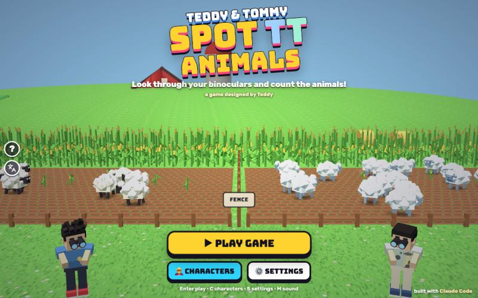

# Spot TT Animals

[](https://adong.github.io/spot-tt-animals/)

Press **?** any time (or tap the round **?** button on the left edge) to see the keys. The game waits while you look.

Teddy's own game. He wrote the design document; this build follows it. Two players look through binoculars into two cornfields split by a fence, and each counts the farm animals in their own field before time runs out: 60, 30 or 15 seconds. Then the binoculars snap shut, and you have **three seconds** to say how many. Five rounds make a game. Teddy has bigger binoculars, Tommy can freeze his animals, and at night the helicopter pilot lights up his own field. Very rarely, a field is empty.

It's built with Claude Code from plain JavaScript and Three.js, on the shared Claude Games kit (the blocky Teddy and Tommy, menu portraits, synth sound, the ? keys panel and English / 中文). There are no image, model or sound files: the farm, the animals and the helicopter are built from boxes, every texture is painted on a canvas, and every sound is synthesised.

**About the tech:** Teddy's document recommends React, TypeScript and Phaser (Part 11), and says that is a recommendation. This game uses the house stack instead, like all its siblings: plain JavaScript in classic `<script>` tags, Three.js r149 from the kit, no npm and no build step, so double-clicking `index.html` works offline. The document's separation is kept:

- `js/config.js` holds every number. Teddy's fixed rules are in `SPOT.RULES`, and the tuning values are in `SPOT.CONFIG`, shaped like his `GAME_CONFIG`.
- `js/sim.js` is the rules and state machine, with no Three.js in it. Node tests it headlessly.

The title is Teddy's. It lives in one constant, `SPOT.TITLE` in `js/title.js`, and the page title, the logo and the ? panel all follow it.

## Play

- **Double-click `index.html`.** It works offline, because Three.js and the kit are copied into `kit/`. Without internet, the title font falls back to Arial Black.
- **Send one file:** `dist/spot-tt-animals.html` is the whole game in one page, about 870 KB. AirDrop or email it, then open it in a browser.
- **Rebuild that file after any edit:** `python3 kit/tools/bundle.py . --name spot-tt-animals`

**PLAY GAME** opens the setup screen (Teddy's Screen 2):

- **TWO PLAYERS** or **VS COMPUTER**.
- 🟢 **EASY** (60 s), 🟡 **MEDIUM** (30 s) or 🔴 **HARD** (15 s) to count.
- ☀️ **DAY**, 🌙 **NIGHT** or 🌗 **MIX**.
- A character for each side.

Then press **START**.

**A round** goes the way the document describes it:

1. **ROUND 1 OF 5**, then **3… 2… 1… GO!**
2. The binoculars open, and both players count at the same time.
3. The clock turns red for the last **5 4 3 2 1**.
4. The lenses snap shut, and **HOW MANY SHEEP?** comes up with **3 seconds** on the clock.
5. Once both answers are locked (or the 3 s are up), the binoculars come away. Every animal in each field gets a number badge, counted out loud with a rising *pip*, including the ones that were hiding outside your lenses.
6. Then: ✅ or ❌ on each side, the actual counts, both answers, who won the round, and the score.

After five rounds you get **WINNER!** (or a draw) with a round-by-round table, your unlock progress, and **PLAY AGAIN**.

## Controls

| | Player 1 (left) | Player 2 (right) | Touch |
|---|---|---|---|
| count +1 · −1 (your hidden clicker) | W · S | ↑ · ↓ | |
| use your power: ❄️ freeze · 🚁 spotlight | A (or Space while counting) | ← (or Enter while counting) | your round power button |
| lock your answer | D (or Space) | → (or Enter) | tap your number, 0 to 20 |
| VS Computer: type the number | 0–9, Backspace | | |
| next round · pause · sound | Enter · P or Esc · M | | NEXT ROUND · ❚❚ · 🔊 |

- **Two players on one keyboard:** your count is a hidden clicker. Press up once for each animal you count, and lock it when the binoculars shut. The box shows **●●** whatever the number, so the other player can't read it, and the clicker makes no sound in two-player mode, so nobody can count your clicks by ear.
- **VS Computer on a keyboard:** just type the number. 3 to 9 and 0 lock at once. 10 to 20 lock at the second digit. A lone 1 or 2 waits 0.8 s for a second digit and then locks by itself; Enter locks it straight away. You can see your own box (the computer can't read it), and a number typed inside the 3 s still counts at the buzzer. The clicker keys work too.
- **Touch (iPad or phone):** when the binoculars shut, each player gets a 0–20 pad on their own side. One tap locks that number. Your power button sits under your binoculars (in the corner when the phone stands up).
- **Mouse:** the number pads can be clicked as well.
- **Menus:** Enter plays, C opens characters, S opens settings. On setup, 1 picks two players, 2 picks VS Computer, Enter starts and Esc goes back. Enter plays again after the final score.

### Why these inputs (the 3-second window)

Teddy's rule 4 gives three seconds to answer, and that is very short for typing. So every input is one or two presses:

- On touch, one tap on a big ordered 0–20 pad.
- Against the computer, one or two digit keys with no Enter needed.
- For two players sharing a keyboard, the count is built *during* the observation with a clicker (like a real wildlife counter), so the 3 s only needs one key to lock it.

The 3 s itself is unchanged. If it turns out too short for Tommy, that's a question for Teddy, not a quiet change here (it's `answerTimeSeconds`, and the check fails if it isn't 3).

### Hidden answers on one screen (and what it can't stop)

The screen only ever reads `match.view()`, which hides every answer and every count until both answers are locked or the 3 s are up. In two players the boxes show ●●; once you lock, you see ✓ LOCKED and "hidden until both are in".

Honestly, though, one shared screen or keyboard can't stop a determined peek:

- on an iPad you can watch where the other finger taps;
- on a keyboard you can watch the other hand.

It doesn't help much, because the two fields always have different counts. Separate devices would need network play, which the document leaves for later.

## How it works

- **The fields:** two cornfields side by side with Teddy's fence between them. There's tall corn at the back and sides, a low rail at the front (so nothing tall stands between you and the animals), and young corn plants that are too thin to hide anything. Each player has their own camera looking down into their own field, and their own field's animals live on their own render layer, so one player's view can never show the other's animals or lights.
- **The animals:** one type per round (rule 1) from Teddy's five:
  - 🐔 chicken (white);
  - 🐄 cow (black and white, horns, swishing tail);
  - 🐑 sheep (fluffy, black face);
  - 🐓 rooster (red, golden neck, green tail);
  - 🐔 hen (brown).

  They wander to a spot, stop to graze or peck, and wander on. They gently push apart, so two never stand on top of each other, and they stay inside the field. Each field has 1 to 20 (rule 8), dealt separately for each player (rule 6).
- **The binoculars** are a fixed view of the middle of your own field (Part 3), drawn as a two-lens frame with rims in your colour: blue for player 1, mint for player 2.
  - Normal binoculars show about 43% of the field, and about 81% of the animals at any moment.
  - Animals near the edges wander in and out of view, so you have to keep watching.
  - Teddy's are 1.5× wider and taller: about 91% of the field and nearly all of the animals. The field itself doesn't change.
  - Both views use the same scale, so animals look the same size to both players.
- **The powers.** Each one changes only its own player's field (rule 15):
  - 🔭 **Teddy: Wide View.** Always on (rule 14).
  - ❄️ **Tommy: Freeze.** Every animal in *his* field stops dead for 3 s. They turn icy and frost creeps round his lens rims, while the clock keeps running. Then the power recharges for 12 s (rule 13), and a ring on the button shows how long is left.
  - 🚁 **The pilot: Spotlight.** At night only, his helicopter flies in where you can see him wave, then climbs to the top rim and floods *his* binoculars with warm light for 5 s. It then rests for 15 s. In the daytime the button says 🌙 NIGHT ONLY and costs nothing.
  - Powers are fresh at the start of every round.
- **Day and night:** both players always share one sky (Part 7). At night the field is dark and blue and the lens edges darken, so animals are harder to see, especially the brown hens and red roosters.
- **Zero rounds:** about one round in a hundred, *one* player (picked at random) gets an empty field. The other gets 1 to 20 as usual, there's no warning, and 0 is the right answer (Part 8, rules 9 and 10).
- **Scoring:**
  - A right answer against a wrong one wins the round.
  - Both right is a draw (rule 18). Both wrong is a draw for now.
  - No answer within the 3 s never counts, even if your clicker happened to be right.
  - A point per round won. Equal points after five rounds is a draw.
- **The computer (VS Computer):** it has its own field, timer, character and powers (CPU Tommy freezes, and the CPU pilot calls the helicopter at night). It counts only its own field and is right 60% / 75% / 90% of the time on easy / medium / hard, nudged slightly by its powers and by the dark. Otherwise it's off by one or two. It answers 0.7 to 2.1 s into the window, and its answer stays hidden until yours is in. It never sees your count: the check proves its answers don't change when only your field changes.
- **Characters and unlocks:**
  - You start with Teddy and Tommy.
  - **2 games won** unlock the helicopter pilot, who is Zoom from the kit, with his headphones. A game is won when a person wins it: either player in two-player mode, you in VS Computer.
  - The CHARACTERS screen shows each power, the lock and your progress. Luna, Bolt and Bruno wait there as **???** cards until Teddy invents their powers, so no powers were made up for them.
  - Progress is saved in the browser (`localStorage` `spotTT.progress`), and setup choices too (`spotTT.settings`).
- **On the farm:** the title screen shows both fields with animals wandering about (two computer players counting in the background) and the brothers standing at the fence with binoculars to their eyes. Now and then one lowers them for his move: Teddy shadow-boxes, Tommy does his Y. On the final screen the winner celebrates with his signature move and the other waves, with confetti.
- **Sound:** synthesised moos, baas, clucks and crows now and then while you count (never one per animal, so the sounds never give the count away), 3-2-1 beeps, a GO whistle, ticks for the last five seconds, a shutter snap, counting pips, freeze shimmer, helicopter whup-whup, fanfares. M or 🔊 mutes.
- **English / 中文:** the kit's round language button (A文, under the ? button) switches every screen live. The game's words are in `js/zh.js`.

## Companion

Not yet. Every family game has a way to call the other brother, but Teddy's document doesn't have one, and it asks the developer not to invent gameplay quietly. So this build has none, and the question is open for Alan (and Teddy):

- One light option: in VS Computer, tap the other brother's face and he waves from the fence and recounts one round with you, as a second guess.
- Another: he tosses a treat but doesn't change the count.

Nothing is built until someone picks.

## Modes

- **Two Players:** two people, side by side on one screen, at the same time (rule 5). On a phone held upright the two views stack, one above the other, with the fence between them.
- **VS Computer:** you against the computer, which plays a character with its own power (rule 17).
- **Difficulty** sets the counting time: 🟢 Easy 60 s, 🟡 Medium 30 s, 🔴 Hard 15 s (rule 3). It's shared by both players, and it also sets how often the computer is right.
- **Sky:** ☀️ Day, 🌙 Night, or 🌗 Mix (a proposal: each round is day or night at random, still the same for both players).
- **Settings:**
  - sound;
  - what happens when both answers are wrong (**DRAW**, the document's prototype rule, or **CLOSEST WINS**, the idea Teddy hasn't decided on);
  - **UNLOCK ALL** and **START OVER** for the characters;
  - the list of proposal numbers, so a grown-up can see what's still undecided.

## Proposals and open questions for Teddy

His document's Part 14, with what this build does for now. Everything here is a configurable default in `js/config.js`, not a rule.

| Question | His document says | What this build does (proposal) | Where to change it |
|---|---|---|---|
| Begin with one character or five? | He suggested both | Two: Teddy and Tommy | `roster.start` |
| The complete starting characters? | Undecided | Teddy (Wide View), Tommy (Freeze); the helicopter pilot unlocks; Luna, Bolt and Bruno are locked ??? cards with no power yet | `roster` |
| How many wins unlock a character? | Undecided | 2 games won unlock the pilot. Either brother's wins count in two-player mode, yours in VS Computer; draws and computer wins don't | `roster.unlocks` |
| An unlock after every victory? | Undecided | No: each win counts towards the next unlock | `roster.unlocks` |
| How long does Tommy Freeze last? | Undecided | 3 s (his GAME_CONFIG) | `characters.tommy.freezeDurationSeconds` |
| Tommy's cooldown? | Undecided | 12 s, from when the freeze ends; powers are fresh each round | `characters.tommy.cooldownSeconds`, `powers.resetEachRound` |
| Who is the helicopter character? | Undecided | Zoom from the kit (cap and headphones), 5 s of light, 15 s rest, night only | `characters.pilot` |
| Can the binoculars scan within their own field? | Needs clarification | No: each view is fixed on the middle of the field, as Part 3 asks for the prototype. Scanning would be a new mechanic | (not built) |
| Both players answer incorrectly? | Prototype default: draw | Draw; Settings can switch to "closest wins" | Settings, `scoring.bothWrong` |
| A different difficulty for each player? | Prototype default: shared | Shared | (not built) |
| How rare are zero-animal rounds? | Very rare; probability undecided | 1% of rounds, one player only | `animals.zeroProbability` |
| One screen or separate devices? | Needs a design decision | One screen, side by side (stacked on a phone held upright), answers hidden; see the honest note above | (not built) |

Other proposals of mine, all in `js/config.js`:

- **Teddy's binoculars:** 1.5× bigger (`characters.teddy.viewMultiplier`).
- **The field:** 18 × 12, with a gentle pull towards the middle (`field.centerPull`). This sets how much the normal binoculars miss: about 19% of the animals at a time.
- **The computer:**
  - right 60 / 75 / 90% of the time, the document's suggestion (`cpu.accuracy`);
  - small nudges for its own powers and for night (`cpu.mods`, all 0 for the plain numbers);
  - answers 0.7–2.1 s into the window (`cpu.answerDelay`);
  - uses a ready power after 1.5–6 s (`cpu.powerWait`).
- **The answer window:**
  - A typed 1 or 2 waits 0.8 s for a second digit (`timing.typedConfirm`).
  - The 3 s ends early once both answers are locked (`timing.endAnswerWhenBothLocked`); it never runs longer.
- **The 🌗 MIX sky:** half the rounds are night (`sky.mixNightChance`).
- **Scoring:** a point per round won and none for a draw (the document's proposed scoring, `scoring`).

## How it's tested

The rules (`js/sim.js`), the computer player (`js/brain.js`) and the config have no Three.js in them. The browser game and the headless check run the same code at a fixed 60 ticks a second.

```bash
node tools/check.js
```

```bash
node tools/check.js --soak --matches=200 [--2p | --cpu] [--easy | --medium | --hard] [--day | --night | --mix]
```

- **Rules (100 checks in 13 groups):**
  - **Teddy's rules in the config:** 5 rounds, 60/30/15 s, 3 s, at most 20, zero rare, a freeze cooldown, Teddy's bigger binoculars.
  - **Timing on every difficulty, two players and VS Computer:**
    - the observation lasts exactly 60 / 30 / 15 s;
    - the answer window lasts exactly 3 s, ends early once both are locked, and never stretches;
    - 3-2-1-GO and 5-4-3-2-1 come at the right moments;
    - powers and clicks never stop the clock.
  - **Answers:** 0 to 20 whole numbers only, locked answers can't change, the clicker stops at 0 and 20, typing 7 / 17 / 20 / a lone 2, and a 1 typed just before the buzzer.
  - **Five-round matches and scoring:**
    - right beats wrong, and both right is a draw;
    - both wrong is a draw, and the closest-wins option works;
    - no answer never counts, even when the clicker was right;
    - 2-1 wins, and 1-1 is a draw.
  - **200,000 deals:** every count is 0–20; never both zero; zero in about 1% of rounds; the gaps between zero rounds vary like dice (no schedule); either player can be the zero; 1–20 equally likely; all five animals come up.
  - **1,500 real rounds:** one animal type per round in both fields; the field shows exactly the count that's scored; a zero round starts with the same messages and screen as any other (no warning).
  - **Tommy Freeze:**
    - his field doesn't move at all for 3 s;
    - the other field moves exactly as if nothing had happened, compared step by step against a match where nobody froze;
    - then the 12 s cooldown, and it works again;
    - the clock runs on.
  - **Wide view:** only Teddy's binoculars are bigger, the other player's never change, and in real rounds he sees more of his animals.
  - **The helicopter:** comes at night and lights only its own player, for 5 s, then rests 15 s. In the daytime it does nothing and costs nothing. On mixed games it works on night rounds only.
  - **Hidden answers:** a locked answer, the clicker and the counts never show and are never sent in any message before the reveal; in VS Computer you see your own box and never the computer's.
  - **The computer:**
    - It never reads your count: in 40 matches, changing only your field never changed its answers, its timing or its powers.
    - It is handed only its own count, character, difficulty and sky.
    - With the nudges off it's right 60/75/90% (±4.5%) over 1,500 rounds each.
    - It always answers within the 3 s.
    - CPU Tommy freezes, the CPU pilot flies at night and never tries in the day.
  - **Unlocks:**
    - you start with Teddy and Tommy;
    - computer wins and draws don't count;
    - the second win unlocks the pilot, once;
    - progress is saved and loaded, and broken saved data starts fresh.
  - **Day and night:** night games are all night, mixed games have both.
- **Sabotage (29 broken setups, all must be caught).** These prove the checks can fail:
  - a config with 4 rounds, 20 s on hard, 5 s to answer, 25 animals, or no freeze cooldown;
  - a game whose answer window really is 5 s, or whose hard round really is 20 s;
  - a game of four rounds;
  - zero for both players, zero 30% of the time, or zero on a schedule;
  - counts that reach 21, or mixed animals in one field;
  - a field showing one animal more than it scores;
  - a freeze with no cooldown, a freeze that freezes both fields, or one that also stops the clock;
  - a helicopter in the daytime, or one that lights both fields;
  - Teddy's binoculars for everyone;
  - a screen or a message that leaks a locked answer, or a two-player clicker that shows its number;
  - a computer that copies your count, is always right, or forgets to answer;
  - both right going to player 1;
  - a clicker number counting without being locked;
  - unlocks that count the computer's wins.
- **Soak:** whole matches with movement:
  - half two players and half VS Computer, on every difficulty and sky, with random characters;
  - little bots press powers and clickers and answer at random moments (some too late, some wrong);
  - every tick checks the phase order, 5 rounds, the counts and types, animals inside the field, a frozen or lit field only with its own power, no answer or count on screen before the reveal, and the final score adding up.
- **Last run:**
  - Rules 100 of 100, sabotage 29 of 29 caught.
  - Soak: 200 of 200 matches finished, 1,000 rounds, 2.6 million ticks, no problems (about 100 s). 9 zero rounds (0.9%).
  - The computer was right 57% / 75% / 90% on easy / medium / hard. The soak keeps its night and power nudges on, which pulls easy a little below 60%.
  - On average the pilot and Tommy each saw 81% of their own animals at any moment; Teddy saw 100%. The closest two animals ever got was 0.89 of their room.
- **In the Browser pane** (served from `~/claude-games` on port 8766), no console messages. Checked:
  - every screen at 1200 × 750 and 800 × 500;
  - phone landscape 740 × 360 and iPad 1024 × 768 with `?touch=1`, and phone portrait 390 × 844;
  - real key presses (two-player clickers and locks) and a real tap on the number pad;
  - 中文 on every screen, through a whole match, with `Kit.lang.untranslated()` coming back empty.
- **Real frames:** a copy of the single page ran with a timer-driven `requestAnimationFrame` (in the gitignored `.claude/`).
  - A hard round's observation took 15.00 s of real time, and the answer window 3.00 s.
  - With the ? panel open for 3 s, the clock didn't move, and it carried on normally after closing.

**Console hooks** (`window.game`), for the browser:

```js
game.start({ mode: 'cpu', difficulty: 'medium', sky: 'night', chars: ['pilot', 'tommy'], seed: 7 })
game.step(2)            // advance 2 s and draw (the Browser pane throttles animation while hidden)
game.freeze(true)       // stop real-time ticking; game.keepAwake() stops the auto-pause when the tab hides
game.state()            // phase, round, sky, animal, each player's lens, power, lock, and what's visible
game.counts()           // the real counts (tests only: the screen never shows them before the reveal)
game.power(0)           // player 0's power
game.adjust(1, 1); game.lock(1)   // player 1's clicker, then lock
game.type(0, 7); game.pick(0, 12) // VS Computer typing, or a tap on the pad
game.skip(0.02)         // jump to the end of the observation
game.next()             // next round (skips the counting animation)
game.screen('chars')    // title, setup, chars, settings
game.unlockAll(); game.resetProgress()
game.check()            // rules and sabotage in the browser; game.soak({ matches: 20 }) runs the soak
```

Add `?touch=1` to the address to see the touch controls on a computer.

## Files

```
index.html       page, HUD, menus, number pads (CSS inline)
js/title.js      the game's name (SPOT.TITLE)
js/config.js     SPOT.RULES (Teddy's fixed rules) and SPOT.CONFIG (all the tuning numbers, proposals marked)
js/sim.js        the rules: rounds, timers, fields and animal movement, powers, answers, scoring, unlocks
js/brain.js      the computer player (only ever sees its own field)
js/check.js      the rule checks, soak and sabotage (browser console and Node)
js/sfx.js        the game's own synth sounds
js/art.js        canvas textures, the farm, the five animals, the helicopter, the brothers with binoculars, the binocular frame
js/game.js       renderer, one camera per player, the loop, HUD, menus, keys and touch, test hooks
js/keys.js       the ? panel's keys (Kit.help)
js/zh.js         the game's words in 中文 (Kit.lang)
tools/check.js   runs js/check.js in Node (no npm)
kit/             copy of ~/claude-games/kit (python3 ../kit/tools/sync.py .); don't edit it here
dist/spot-tt-animals.html  the single-page build
```

## Kit candidates

These are written here first. They're worth moving into `~/claude-games/kit` if another game wants them:

- **Split-screen views, one camera each** (`render` and `layout` in `js/game.js`). It uses a scissored viewport per player, per-view lighting set just before each render, and a render layer per player, so nothing (animals, lights, effects) can leak from one view to the other.
- **The binocular frame** (`paintMask` in `js/art.js`), painted on a 2D canvas over a view:
  - two lenses with rims;
  - day, night and spotlight shading;
  - frost round the edge;
  - lens caps that iris open and shut.
- **Box-built farm animals** (`BUILD` in `js/art.js`): a cow, a sheep, and chickens, hens and roosters from one bird builder, with walking legs, grazing heads and pecking.
- **A Kit person holding binoculars up** (`makeKid` / `poseKid` in `js/art.js`).

## Not verified

- **Sound:** every effect is wired up, but nobody listened in this build. The test browser has no audio check.
- **Real touch devices:** touch was tested in the Browser pane with simulated taps, at phone landscape, phone portrait and iPad sizes with `?touch=1`. It wasn't tried on a real iPhone or iPad.
- **Two kids on one keyboard:** the key layout (WASD against the arrows, both clickers) was pressed by a script, not by two real players side by side.
- **Whether 3 s is enough for Tommy** to tap or type his number, and whether counting 20 moving animals in 15 s is fun or just hard. The numbers in `js/config.js` are there to tune after the brothers try it.
- **Night difficulty:** the dark is a guess. It may be too easy or too hard to see the brown hens and red roosters.
- **Long real-time sessions:** most play was driven with `game.step()`. The real-frames copy ran one full round and a second round with the ? panel open.
